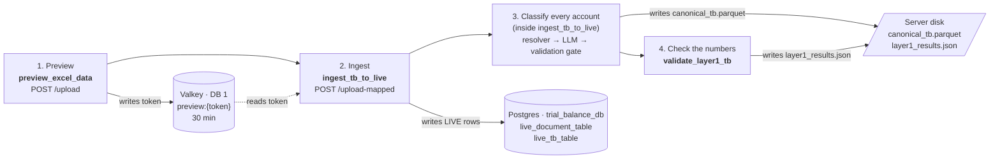
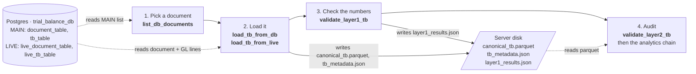

# Trial Balance data flow

Where a trial balance goes, which tool touches which store, and how long each piece of data stays.

The upload path writes a trial balance into the database. The load path reads one back out. Both end in the same `canonical_tb.parquet` working file, so the audit that follows is identical.

## Stores

| Store | Medium | Used for |
|---|---|---|
| **Valkey, DB 1** | In memory (RAM) | Upload preview token, chat memory, caches |
| **Postgres `trial_balance_db`** | Database on disk | LIVE uploads, MAIN finalized documents, run records, chat history |
| **Server disk** (`TB_OUTPUT_DIR`) | Files | Uploaded workbook, `canonical_tb.parquet`, `tb_metadata.json`, `layer1_results.json`, analytics outputs |
| **MinIO** (bucket `tb-artifacts`) | Object store | Durable copy of generated reports. **Off** in the current configuration. |

## A. Upload a file into the database

| Step | Tool | What it does |
|---|---|---|
| 1 | `preview_excel_data` | Reads the workbook and returns the first rows. Saves the file and stores a preview token in Valkey. |
| 2 | `ingest_tb_to_live` | Reads the token, detects the input layout, parses the workbook, runs the quality gate. |
| 3 | (inside `ingest_tb_to_live`) | Maps each account to a Schedule III head: exact name, alias, similar meaning, fixed rules, then the LLM, then a final check against the real list of heads (one retry, else marked unmatched). Writes the document and GL lines to LIVE and writes `canonical_tb.parquet`. |
| 4 | `validate_layer1_tb` | Debits equal credits, balances sum to zero, and the other Layer 1 checks. |

If the data quality is poor, step 3 stops and asks for confirmation before spending any LLM calls.

## B. Use a trial balance already in the database

| Step | Tool | What it does |
|---|---|---|
| 1 | `list_db_documents` | Lists the MAIN documents, shared by everyone. |
| 2 | `load_tb_from_db` / `load_tb_from_live` | Reads the document and its GL lines from MAIN, or from your LIVE upload, and rebuilds `canonical_tb.parquet` and `tb_metadata.json`. No parsing or LLM classification is needed, because the lines were classified when they were saved. |
| 3 | `validate_layer1_tb` | The same checks as the upload path. |
| 4 | `validate_layer2_tb` | The six rules that need the account grouping, then the analytics chain. |

When an uploaded document is audited, MAIN is tried first and LIVE is the fallback, so a document that exists in both never silently uses the staging copy.

## What is stored, and for how long

Lifetimes come from the code and the current settings. "Marked deleted" means a flag is set on the row; the data is not erased.

| What | Store | Medium | How long it stays |
|---|---|---|---|
| `preview:{token}`: upload preview and saved file path | Valkey, DB 1 | Memory | **30 minutes**. After that, Run returns "unknown or expired token" and you upload again. |
| `agentchat:{session}`: conversation memory for questions | Valkey, DB 1 | Memory | **2 hours**. Rebuilt from the database chat history when it has expired. |
| `chatcache:…`: cached answers to chat lookups | Valkey, DB 1 | Memory | **5 minutes** |
| `failedcall:…`: stops the agent repeating a failed tool call | Valkey, DB 1 | Memory | **10 minutes** |
| `trace:*`: live trace events (only when started with `live_trace.asgi:app`) | Valkey, DB 1 | Memory | **24 hours** |
| Uploaded workbook, `uploads/{token}/` | Server disk | File | **Until someone deletes it.** No job removes upload folders. |
| Your uploaded trial balance: `live_document_table`, `live_tb_table` | Postgres (LIVE) | Database | **Until you delete it**, with `delete_db_document`. Only your own documents, never MAIN. |
| Finalized trial balances: `document_table`, `tb_table` | Postgres (MAIN) | Database | **Permanent.** Filled by a separate promotion process that is not in this code. Read-only here. |
| Run records: `pipeline_sessions`, `pipeline_findings`, `pipeline_artifacts` | Postgres | Database | **90 days**, then marked deleted. Done by the `cleanup_sessions` script when someone schedules it. |
| Chat history: `pipeline_chat_messages` | Postgres | Database | **90 days**, then marked deleted. Same script. |
| Working files: `canonical_tb.parquet`, `tb_metadata.json`, `layer1_results.json`, analytics outputs in `sessions/{id}/` | Server disk | Files | **Kept, in practice.** The cleanup removes a session folder after 90 days only if every file has a MinIO copy. MinIO is off, so nothing is removed. |
| Generated reports (Excel, Word) | MinIO | Object store | **Not stored there.** Turn on with `TB_MINIO_ENABLED=true` and credentials. |

## Things to know

- **Valkey is a cache, not a record.** Losing it only costs the preview step and chat memory. A trial balance is safe in Postgres once Run finishes. Whether the Valkey server also saves its data to disk depends on how it was started; this was not checked.
- **Disk growth.** Upload folders and session folders have no automatic cleanup in the current setup, so `TB_OUTPUT_DIR` grows with every run until someone clears it.
- **Where the code is.** Tools are under `backend/modes/trial_balance/pipeline/tools/` (`db_bridge.py` has the load and ingest tools, `canonical.py` has the validation tools). Valkey keys and lifetimes are in `pipeline/valkey_client.py`. The retention job is `scripts/cleanup_sessions.py`.
